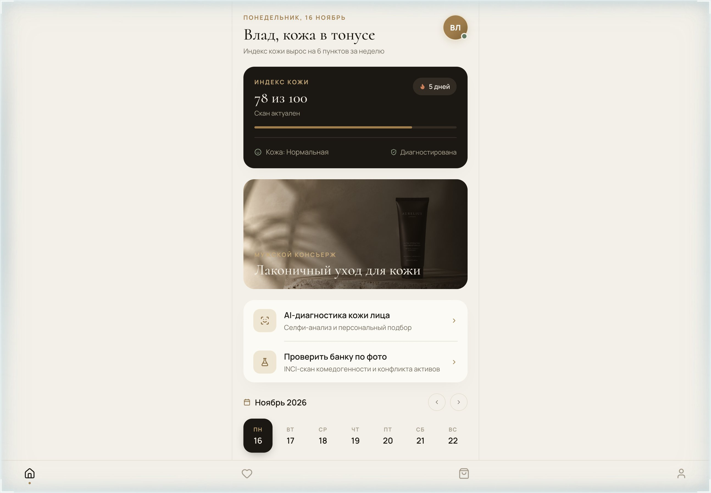
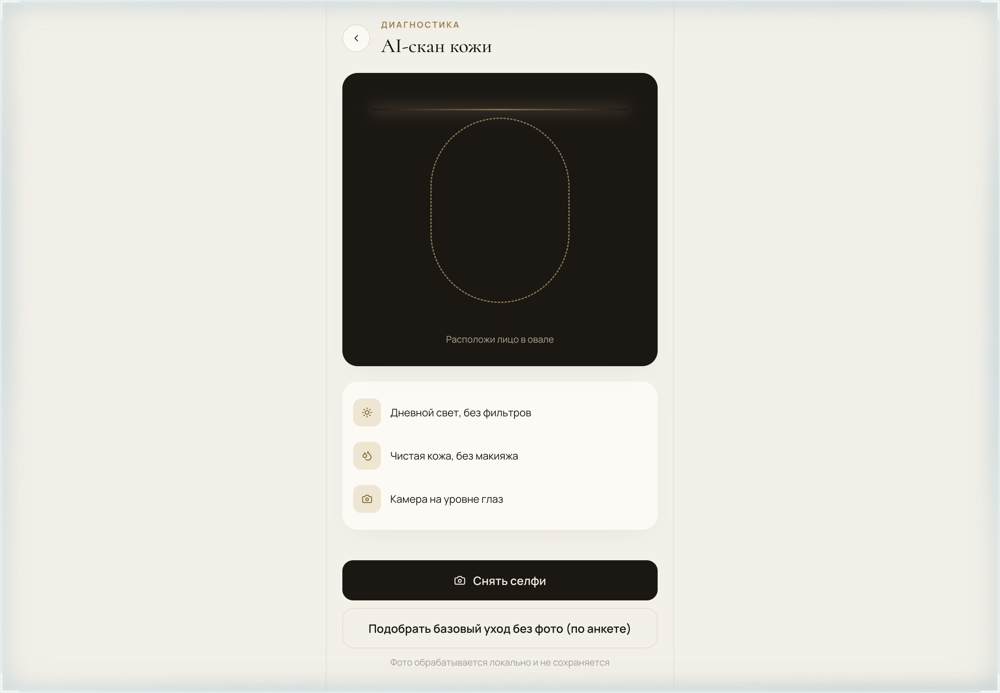
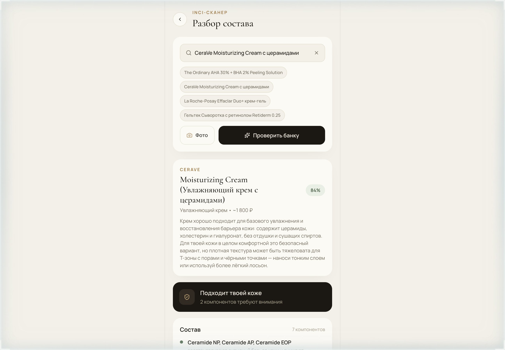
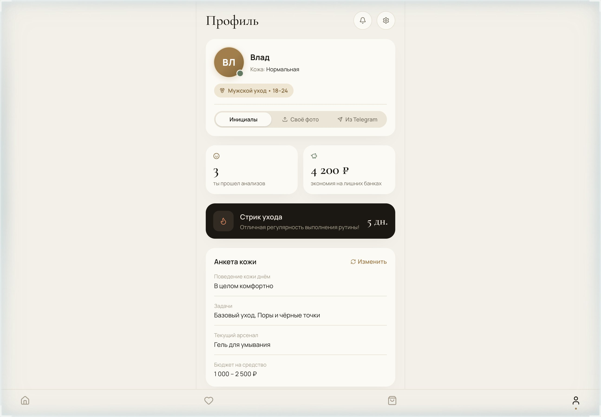

# LUMI — AI-консьерж мужского ухода за кожей

Telegram Mini App: селфи-анализ кожи, разбор состава INCI и персональная
рутина ухода от AI-консьержа. Дизайн-система — «мужской консерж»
(шрифтовая пара Cormorant + Manrope, латунно-чернильная палитра).






## Возможности

- **AI-диагностика кожи по селфи** — индекс кожи 0–100, метрики
  (увлажнённость, тон, поры, воспаления), заключение и персональная
  рутина (утро/вечер) с реальными брендами.
- **INCI-сканер** — фото банки или название средства: разбор состава,
  комедогены и раздражители, проверка конфликтов с текущей рутиной,
  безопасный аналог при несовместимости.
- **Профиль** — анкета кожи, история сканирований, стрик ухода,
  статистика экономии, настройка собственного Telegram-бота
  (webhook + кнопка Mini App + AI-отчёты).

## Стек

- React 18 + TypeScript + Tailwind CSS, Vite
- Сервер: `tsx server.ts` (Express-совместимый, порт 3000)
  — прокси к OpenRouter (OpenAI-compatible API), vision-модель
  `particle-ai/particle-1:free`
- Хостинг данных: localStorage (MVP), Google Sheets / Postgres — в дорожной карте

## Запуск локально

```bash
npm install --include=dev
cp .env.example .env        # прописать MOONSHOT_API_KEY
NODE_ENV=development npx tsx server.ts
# открыть http://localhost:3000
```

Переменные окружения:

| Переменная | Назначение |
|---|---|
| `MOONSHOT_API_KEY` | Ключ OpenRouter (`sk-or-v1-...`) |
| `MOONSHOT_BASE_URL` | `https://openrouter.ai/api/v1` |
| `LUMI_AI_MODEL` | Модель, по умолчанию `particle-ai/particle-1:free` |

## Дизайн

Дизайн-код сгенерирован в Kimi Design и синхронизирован в
[.kimi-design/](.kimi-design/) (три страницы: design-system, ui-kit, app —
9 экранов и 8 компонентов). Откат до предыдущей визуальной версии:
git-тег `pre-kui-design`.

## Статус

MVP в активной разработке (грант «Студенческий стартап», заявка — декабрь 2026).
В плане: ежедневные пуш-напоминания от бота, расширение базы INCI,
онбординг и магазин по мере готовности.
